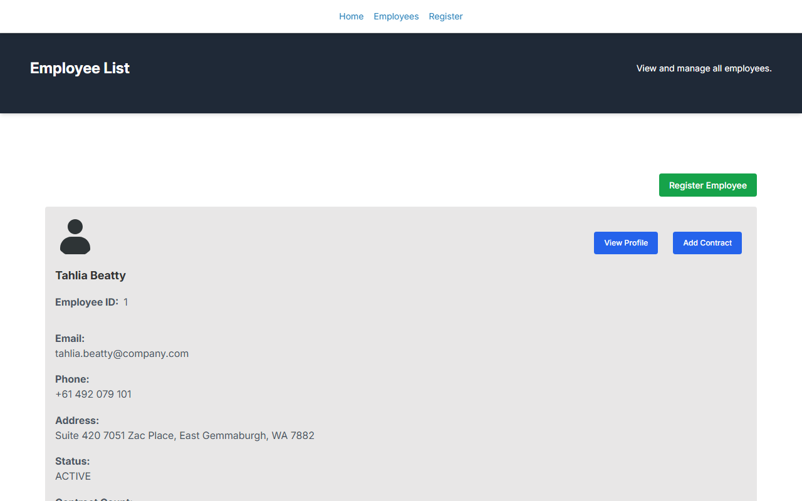
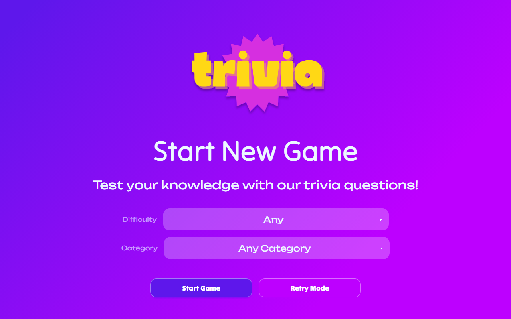
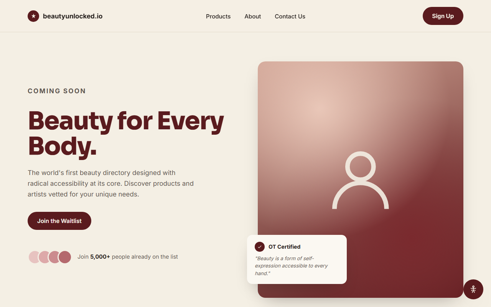
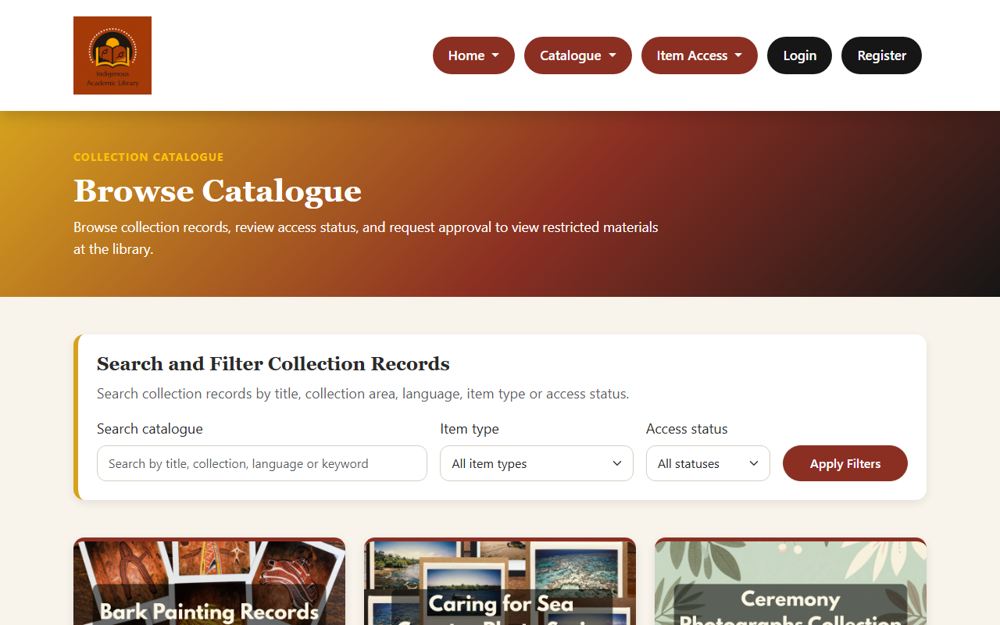

<h1 align="center">Front-end / full-stack developer: bridges design and code</h1>
<h3 align="center">Sydney. Open to graduate and startup roles.</h3>

## Live project demos

<table>
  <tr>
    <td align="center" width="50%">
      
       
      <b>Employee Creator API</b> - <a href="https://employeecreator.site/">Live demo</a>
      
      
       
      HR management system built with Spring Boot, React and TypeScript. Built solo.
    </td>
    <td align="center" width="50%">
      
       
      <b>Trivia App</b> - <a href="https://mytriviagame.lol/">Live demo</a>
      
      
      
       
      Full stack trivia React app with REST API for saving game sessions and retry data. Pair programming project.
    </td>
  </tr>
  <tr>
    <td align="center" width="50%">
      
       
      <b>Waitlist Site</b> - <a href="https://waitlist-site-pearl-nine.vercel.app/">Live demo</a>
      
      
      
       
      Waitlist landing page template with a built-in accessibility overlay. Designed for startups.
    </td>
    <td align="center" width="50%">
      
       
      <b>Indigenous Library</b> - <a href="https://indigenouslibrary.site/">Live demo</a>
      
      
      
       
      Library portal website for managing collections of cultural artefacts. Team project.
    </td>
  </tr>
</table>

I'm also building AI-agent tooling, see [job-application-agent](https://github.com/carriegale2710/job-application-agent).

## About

I'm a junior full-stack developer who started out as a UX/UI designer. Finished a 4 month long software engineering bootcamp last year, realised I'd rather build and ship fast than run neverending design sprints. Got a Graduate Certificate of IT from QUT this year. My first love of design still helps. Knowing what to build (and more importantly, what NOT to build) is what makes or breaks good code (also preventing _ahem_ AI slop...). Also:

- Shipped a role-based notes feature in an Agile internship (NestJS, MySQL, Next.js).
- Built and deployed full-stack apps with React, TypeScript, Java/Spring Boot and SQL, with automated tests and CI. Best ones are pinned below.

- 🌱 Currently learning **prompt-engineering** and building **micro-SaaS apps**
- 💬 Ask me about **applying product thinking to programming**

## Tech stack

<table>
  <tr>
    <th align="left">Front-end</th>
    <td align="center" width="96">
      <a href="https://reactjs.org/"> React</a>
    </td>
    <td align="center" width="96">
      <a href="https://www.typescriptlang.org/"> TypeScript</a>
    </td>
    <td align="center" width="96">
      <a href="https://developer.mozilla.org/en-US/docs/Web/JavaScript"> JavaScript</a>
    </td>
    <td align="center" width="96">
      <a href="https://www.figma.com/"> Figma</a>
    </td>
    <td align="center" width="96">
      <a href="https://developer.mozilla.org/en-US/docs/Web/HTML"> HTML</a>
    </td>
    <td align="center" width="96">
      <a href="https://developer.mozilla.org/en-US/docs/Web/CSS"> CSS</a>
    </td>
  </tr>
  <tr>
    <th align="left">Back-end</th>
    <td align="center" width="96">
      <a href="https://www.java.com"> Java</a>
    </td>
    <td align="center" width="96">
      <a href="https://spring.io/"> Spring</a>
    </td>
    <td align="center" width="96">
      <a href="https://www.mysql.com/"> MySQL</a>
    </td>
    <td align="center" width="96">
      <a href="https://nodejs.org"> Node.js</a>
    </td>
    <td align="center" width="96">
      <a href="https://www.python.org/"> Python</a>
    </td>
    <td align="center" width="96">
      <a href="https://flask.palletsprojects.com/"> Flask</a>
    </td>
  </tr>
</table>

## Contact

<table>
  <tr>
    <td align="center" width="50%">
      <b>📫 Email</b>
       
      carriegale2710 (at) gmail (dot) com
    </td>
    <td align="center" width="50%">
      
       
      <b><a href="https://linkedin.com/in/carrie-gale" target="blank">LinkedIn</a></b>
    </td>
  </tr>
</table>
